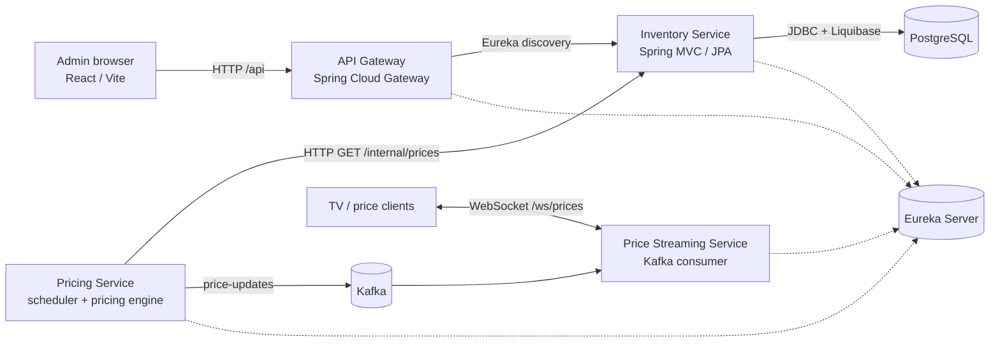

# CryptoCraft Architecture

## Overview

CryptoCraft is a microservice-oriented prototype for inventory administration and dynamic menu pricing. The implemented path covers inventory CRUD, scheduled price generation, Kafka-based price events, and WebSocket price broadcasts. The repository's README describes a broader restaurant platform, but order management, reservations, payment processing, bonuses, and analytics are not implemented as services in the current codebase.

## System context

Eureka is used for registering services and for the gateway's inventory route. The Pricing service's Inventory client currently calls `http://inventory-service:8081` directly instead of using Eureka discovery.

## Modules and responsibilities

| Module | Responsibility and key implementation |
|---|---|
| `admin-ui` | React 19 and TypeScript admin application. Provides brand, product, and item screens; uses Axios for REST requests and TanStack Query for loading, mutations, and cache invalidation. |
| `api-gateway` | Spring Cloud Gateway (WebFlux), listening on port `8765`. Routes `/api/v1/brands/**`, `/api/v1/products/**`, and `/api/v1/items/**` to Inventory using Eureka service discovery. |
| `eureka-server` | Spring Cloud Netflix Eureka registry, listening on port `8761`. |
| `inventory-service` | Spring MVC REST API on port `8081`; manages brands, products, items, recipes/item-product links, and product stock. Uses JPA/Hibernate, PostgreSQL, and Liquibase. Implements tenant context and PostgreSQL row-level security. |
| `pricing-service` | Spring service on port `8082`. Periodically loads item base/min/max prices from Inventory, calculates new prices, caches the current prices in memory, and publishes `PriceEvent`s to Kafka. |
| `price-streaming-service` | Spring WebFlux service on port `8083`. Consumes Kafka price events and broadcasts them to connected WebSocket clients. WebSocket endpoint: `/ws/prices`. |
| `authentication-service` | Separate Spring Security/OAuth2 module with Google/Apple client configuration and a minimal root controller. It is not included in the root Gradle `settings.gradle` or either Compose stack, and is not wired into the gateway in the current configuration. |
| `platform` | Gradle Java platform/BOM centralizing Spring Boot, Spring Cloud, PostgreSQL, MapStruct, and related dependency versions. |

## Request and event flows

### Admin inventory requests

1. The React admin UI calls `/api/v1/brands`, `/api/v1/products`, or `/api/v1/items`.
2. In the Vite development server, `/api` is proxied to the API Gateway (default `http://localhost:8765`). The UI's Axios interceptor can attach `X-Tenant-Id`.
3. The Gateway forwards the request to the Inventory Service through its configured Eureka route.
4. Inventory's servlet filter establishes tenant context, then its controllers, services, repositories, and JPA entities perform the operation.
5. Inventory reads or writes PostgreSQL. Liquibase applies schema changes at startup.

Product creation, for example, validates the request and referenced brand, checks for an existing product with the same case-insensitive name and brand, maps the DTO to a `Product` entity, persists it, and returns a `ProductResponseDto`.

### Dynamic price streaming

1. `PriceConfigScheduler` refreshes the Pricing service's price configuration from Inventory's `GET /internal/prices` endpoint every hour.
2. `PricingScheduler` ticks every 100 ms and processes one of 30 item groups per tick.
3. `PricingEngine` calculates a bounded price between each item's configured minimum and maximum and publishes a `PriceEvent` to Kafka topic `price-updates`.
4. `PriceConsumer` in the Price Streaming service consumes that topic.
5. `PriceBroadcastService` serializes each event and sends it to every connected session at `/ws/prices`.

There is no implemented flow connecting orders or payments to price changes. Pricing changes are currently generated by a random movement/correction algorithm.

## Data and persistence

Inventory stores the primary relational data in PostgreSQL:

- `brands`: product brands.
- `products`: name, description, image, stock quantity, unit, brand, and tenant.
- `items`: menu items and price configuration (`base_price`, `min_price`, `max_price`).
- `item_products`: recipe links from items to products, with quantities.
- `tenants`: tenant records used by tenant-aware entities and policies.

Liquibase change sets create and evolve the schema, seed sample data and prices, and configure PostgreSQL row-level security for tenant-scoped inventory tables. Pricing's active configuration and current prices are in-memory caches; Kafka carries price events. No persistent order, payment, or price-history store is implemented.

## Technologies and runtime

- **Backend:** Java 21, Gradle, Spring Boot, Spring MVC, Spring WebFlux, Spring Data JPA, Spring Security/OAuth2 configuration, Spring Cloud Gateway, Eureka.
- **Database and messaging:** PostgreSQL, Liquibase, Kafka, Zookeeper (for the configured Kafka broker).
- **Frontend:** React, TypeScript, Vite, Material UI, TanStack Query, Axios.
- **Local orchestration:** Docker Compose, Kafka UI, PostgreSQL volume.

`docker-compose.yml` defines Eureka, PostgreSQL, Inventory, Pricing, Kafka/Zookeeper, Kafka UI, Price Streaming, and API Gateway. It exposes the relevant service ports and also exposes JVM debug ports for several services. `docker-compose-prod.yml` is currently a reduced stack with Eureka, PostgreSQL, Inventory, Gateway, and the admin UI; it does not include Kafka, Pricing, or Price Streaming. The admin UI Docker image runs the Vite development server rather than a production static web server.

## Security and tenant model

The Inventory tenant filter currently assigns tenant ID `1` to every request rather than deriving it from authenticated claims or validating the UI's `X-Tenant-Id` header. A tenant-aware data-source wrapper sets PostgreSQL's `app.tenant_id` session setting, and Liquibase configures row-level security policies. The design therefore contains tenant-isolation mechanisms, but tenant selection is not yet connected to trusted identity.

OAuth2 client settings for Google and Apple exist in the separate Authentication module, but that module is not integrated into the running Compose architecture. The current Gateway configuration does not define authentication filters for its inventory routes.

## Boundaries and known gaps

- The running architecture is primarily inventory management plus a demonstration price event pipeline. README features such as orders, stock reservations, payment provider webhooks, bonuses, analytics, and business events remain future work.
- Price configuration refresh is scheduled hourly, and the initial `@PostConstruct` refresh is commented out. On startup, Pricing can therefore have no configured items until its first scheduled refresh.
- Price state and version counters are local to a Pricing process; a restart loses them. Multiple Pricing replicas would each run the scheduler and could generate competing price streams.
- The WebSocket service currently broadcasts each update to all connected sessions; there is no subscription/filtering, authorization, or explicit backpressure/failed-send policy.
- The Inventory client uses a hard-coded Docker hostname and suppresses call failures by logging and returning an empty list. Several Kafka/service addresses are also configured directly in code or YAML.
- Compose uses a fixed PostgreSQL password and publishes debug ports. These settings are suitable only for development and need secret management, access restrictions, health checks, and production-grade deployment configuration before production use.
- The Gateway exposes actuator endpoints including `env` and `configprops` in its route configuration; actuator access should be restricted in deployed environments.

## Main source locations

- `settings.gradle`, `platform/build.gradle`: Gradle modules and shared dependency versions.
- `docker-compose.yml`, `docker-compose-prod.yml`: service topology and local/deployment profiles.
- `api-gateway/src/main/resources/application-*.yml`: routes, discovery, and ports.
- `inventory-service/src/main/java/.../controllers`, `services`, `repositories`, `dao`: Inventory API and persistence.
- `inventory-service/src/main/resources/db/changelog`: schema migrations and seed data.
- `pricing-service/src/main/java/.../scheduler`, `pricing`, `kafka`, `client`: price config refresh, computation, and event production.
- `price-streaming-service/src/main/java/.../kafka`, `websocket`: event consumption and WebSocket broadcasting.
- `admin-ui/src/api`, `pages`, `components`: admin UI API client and management screens.
